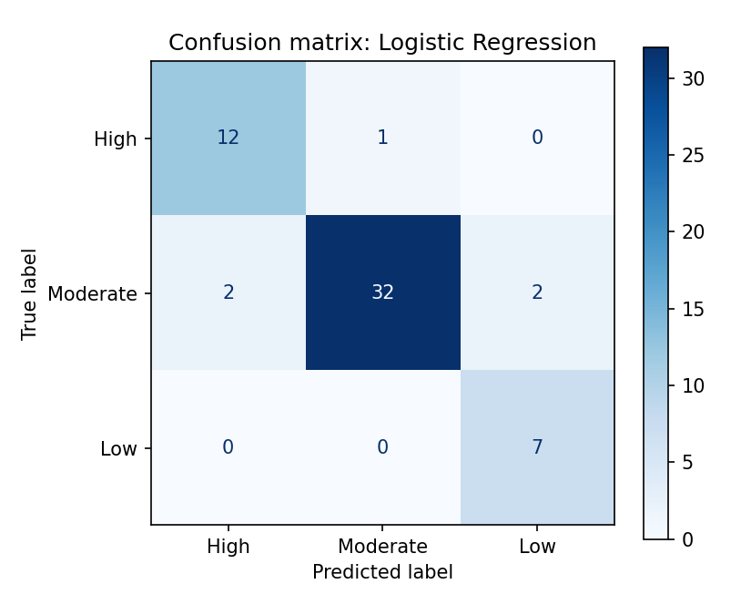
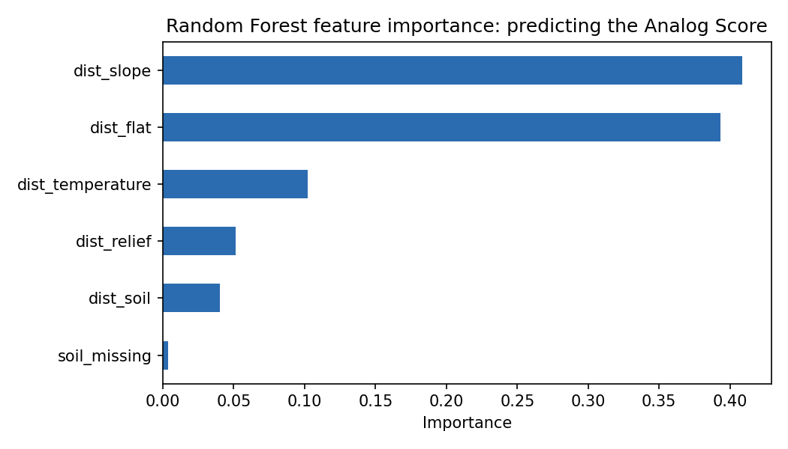
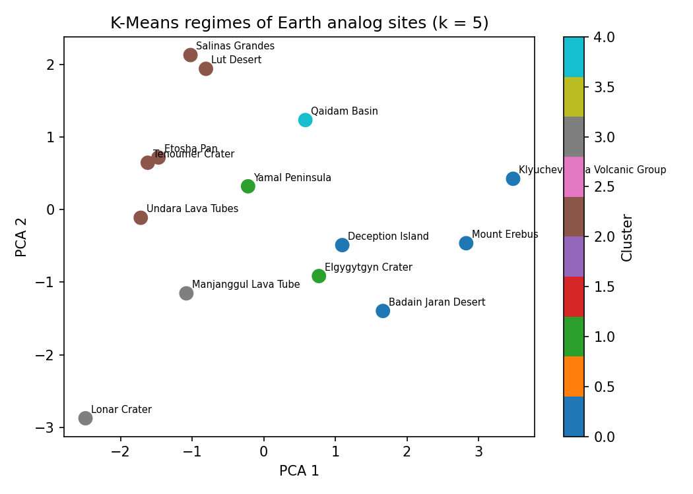
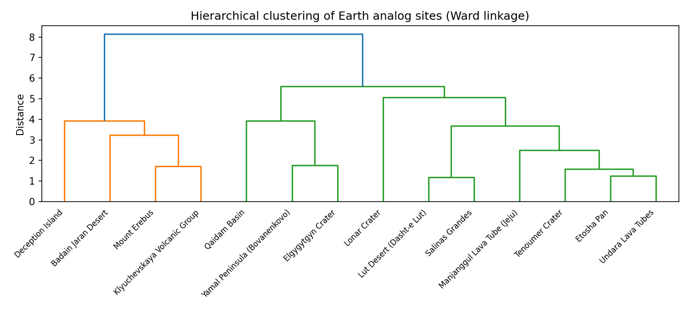
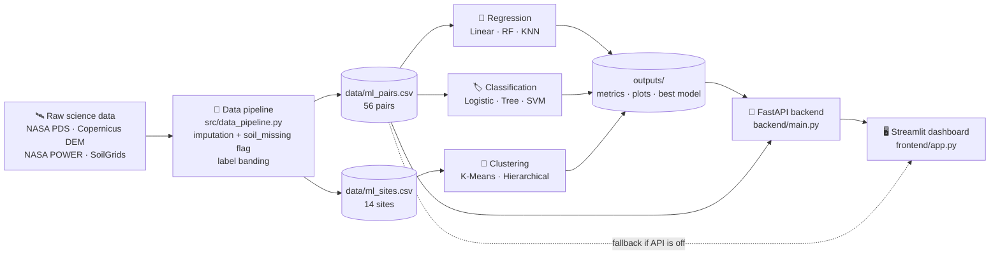

<div align="center">

# 🌕 ATLAS-ML

### *Finding Earth's Moon-like places, with machine learning*

**Machine Learning Lab (AI-3202) · Lab 14: Complex Computing Activity**
**Dawood University of Engineering & Technology, Karachi**

[](https://www.python.org/)
[](https://scikit-learn.org/)
[](https://fastapi.tiangolo.com/)
[](https://streamlit.io/)
[](https://pandas.pydata.org/)
[](https://numpy.org/)
[](https://pytest.org/)


</div>

> NASA plans permanent bases at four lunar polar sites: **Peary, Shackleton, de Gerlache and Amundsen**.
> Before habitats and rovers are tested on the Moon, engineers need places on Earth that behave the same way.
> ATLAS-ML profiles the 4 Moon bases and 14 candidate Earth sites from real satellite data, scores all **56 base-site pairs**,
> and then trains machine learning models to **predict**, **classify** and **cluster** those analogs.

<div align="center">

### 🏆 Best match found for each lunar base

| 🌕 Lunar base | 🌍 Best Earth analog | ⭐ Analog Score |
|:---:|:---|:---:|
| de Gerlache | Mount Erebus, Antarctica | **72.1** |
| Shackleton | Klyuchevskaya Volcanic Group, Russia | **69.7** |
| Peary | Elgygytgyn Crater, Russia | **63.1** |
| Amundsen | Mount Erebus, Antarctica | **62.7** |

</div>

---

<a id="contents"></a>
## 📚 Contents

| | |
|:---|:---|
| [✨ What ATLAS-ML does](#what-it-does) | [📊 Results](#results) |
| [🖼️ Visual showcase](#showcase) | [🚀 Quick start](#quick-start) |
| [🧠 The three ML tasks](#ml-tasks) | [💻 Usage and demo](#usage) |
| [🏗️ Architecture](#architecture) | [🔌 API documentation](#api) |
| [📂 Project structure](#structure) | [🧪 Testing](#testing) |
| [🗄️ Data and sources](#data) | [⚠️ Limitations and ethics](#limitations) |
| [🧭 Lab concepts map](#lab-map) | [🔮 Future improvements](#future) |
| [👥 Team](#team) | [🤝 Contributing](#contributing) |
| [🙏 Acknowledgements](#acknowledgements) | |

---

<a id="what-it-does"></a>
## ✨ What ATLAS-ML does

ATLAS-ML started as the team's **ATLAS** project for the NASA Space Apps Challenge 2026, which measured how similar
14 real Earth sites are to 4 planned lunar polar bases. This project takes that science pipeline one step further
and asks: **can machine learning learn, reproduce and explain those similarity scores?**

For every Moon base and Earth site pair, five pillar distances are computed (slope, flat area, temperature,
relief and soil). The original ATLAS engine combines them into one **Analog Score**:

```text
Analog Score = 100 * exp(-weighted Euclidean distance)
weights: slope 0.30 · flat 0.20 · temperature 0.20 · soil 0.15 · relief 0.15
(weights were fixed before seeing the results)
```

ATLAS-ML then builds three machine learning systems on top of those 56 scored pairs, serves them through a
**FastAPI** backend, and presents them in a **Streamlit** dashboard with a live prediction playground.

### Key features

- 🔭 **Real data only**: lunar measurements from NASA PDS instruments, Earth terrain from Copernicus DEM,
  climate from NASA POWER and soil from SoilGrids 2.0 (full source list in [Data and sources](#data))
- 🧹 **Honest preprocessing**: 12 of 56 pairs have no soil data (SoilGrids has no Antarctica or Etosha coverage).
  Instead of deleting them, the pipeline median-imputes the value **and** adds a `soil_missing` flag
- 🎯 **Three ML task types in one project**: regression, classification and clustering, all evaluated with
  5-fold cross-validation because 56 samples are too few for a single lucky split
- ⚖️ **Imbalance-aware classification**: suitability classes are uneven (36 Moderate, 13 High, 7 Low), so the
  project reports per-class precision and recall from stratified folds, not accuracy alone
- 🔁 **A backend that never breaks**: the prediction API uses the trained model when it exists and falls back
  to the original ATLAS formula when it does not
- 🖥️ **A frontend with a fallback too**: the dashboard tries the API first and reads the local CSV files
  when the backend is not running, so the demo always works

---

<a id="showcase"></a>
## 🖼️ Visual showcase

All four plots below are generated by the model scripts in this repository and live in `outputs/plots/`.

| | |
|:---:|:---:|
|  |  |
| **Classification**: confusion matrix of the best classifier (Logistic Regression, out-of-fold predictions) | **Regression**: which pillars drive the Analog Score, according to Random Forest |
|  |  |
| **Clustering**: the 14 Earth sites grouped into environmental regimes (K-Means, best k = 5) | **Clustering**: the same sites grouped hierarchically (Ward linkage), agreement with K-Means: ARI 0.81 |

---

<a id="ml-tasks"></a>
## 🧠 The three ML tasks

| | 🎯 Regression | 🏷️ Classification | 🧩 Clustering |
|:---|:---|:---|:---|
| **Question** | Can we predict a pair's Analog Score from its 5 pillar distances? | Is a pair High, Moderate or Low suitability? | Do the 14 Earth sites fall into natural environmental regimes, with no labels at all? |
| **Data** | 56 pairs, 6 features (5 distances + soil-missing flag) | 56 pairs, classes banded from the score: High ≥ 60, Moderate 45 to 60, Low < 45 | 14 sites, 7 physical features |
| **Models** | Linear Regression, Random Forest, KNN | Logistic Regression, Decision Tree, SVM (RBF) | K-Means (k scanned 2 to 6), Hierarchical (Ward) |
| **Evaluation** | 5-fold CV: MAE, RMSE, R² | 5-fold stratified CV accuracy + per-class report | Silhouette score, Adjusted Rand Index between the two methods |
| **Winner** | Linear Regression, R² **0.982** | Logistic Regression, **91.1%** | Best k = 5, silhouette 0.279, ARI **0.81** |
| **Code** | `src/models/regression.py` | `src/models/classification.py` | `src/models/clustering.py` |

<details>
<summary><b>💡 Why does a simple Linear Regression beat Random Forest here?</b> (click to expand)</summary>

<br>

Only 56 samples, and the score is a smooth, near-monotonic function of the five distances.
A simple linear model generalises better on smooth, low-noise data, while a Random Forest cannot
extrapolate beyond the range it saw in training. The forest is still valuable: its feature
importance shows which pillars drive the score. The regressors are best understood as fast,
interpretable **surrogates** of the scoring engine, not as independent discoveries.

</details>

<details>
<summary><b>💡 Why cross-validation instead of one train/test split?</b> (click to expand)</summary>

<br>

With only 56 rows, a single split is luck-dependent: a few easy or hard pairs landing in the test
set can swing the score either way. 5-fold cross-validation averages over five different splits,
so every reported number in this README is an average, not a best case.

</details>

---

<a id="architecture"></a>
## 🏗️ Architecture



**Workflow, in plain words:** raw profiles are cleaned by one pipeline script into two model-ready
datasets. Three independent model scripts read those datasets and write every metric, plot and the
trained best model into `outputs/`. The backend serves the data, the metrics and live predictions.
The dashboard displays rankings and results, and its prediction playground calls the backend.

---

<a id="structure"></a>
## 📂 Project structure

```text
atlas-ml-cca/
├── README.md                  ← you are here
├── requirements.txt           ← all Python dependencies
├── data/
│   ├── moon_profiles.csv      ← 4 lunar bases (NASA PDS)
│   ├── earth_profiles.csv     ← 14 Earth sites (DEM, climate, soil)
│   ├── scores_ranking.csv     ← 56 pairs with pillar distances + Analog Score
│   ├── ml_pairs.csv           ← generated: model-ready pairs dataset
│   └── ml_sites.csv           ← generated: model-ready sites dataset
├── src/
│   ├── data_pipeline.py       ← Lab 1: preprocessing, imputation, label banding
│   └── models/
│       ├── regression.py      ← Labs 2, 5, 8
│       ├── classification.py  ← Labs 3, 4, 6
│       └── clustering.py      ← Labs 10, 11
├── backend/
│   ├── main.py                ← FastAPI service (6 endpoints)
│   └── README.md              ← API notes
├── frontend/
│   └── app.py                 ← Streamlit dashboard (3 sections)
├── notebooks/
│   └── 01_eda.ipynb           ← exploratory data analysis
├── tests/
│   └── test_pipeline.py       ← 4 pipeline smoke tests (pytest)
├── outputs/
│   ├── metrics/               ← result tables (CSV, JSON, text report)
│   ├── plots/                 ← confusion matrix, importance, clusters, dendrogram
│   └── models/                ← trained best regressor (.joblib, git-ignored)
└── docs/
    └── ATLAS-ML_Lab14_Report.pdf  ← the Lab 14 report (3 to 5 pages)
```

---

<a id="results"></a>
## 📊 Results

All numbers below are reproduced by the scripts in this repo and stored in `outputs/metrics/`.
Cross-validation is 5-fold throughout (stratified for classification).

### 🎯 Regression: predicting the Analog Score

| Model | CV MAE | CV RMSE | CV R² | Test R² |
|:---|:---:|:---:|:---:|:---:|
| **Linear Regression** | **0.82** | **1.00** | **0.982** | 0.987 |
| Random Forest | 3.26 | 3.86 | 0.729 | 0.815 |
| KNN Regressor (k = 5) | 3.20 | 4.10 | 0.696 | 0.850 |

### 🏷️ Classification: suitability class

| Model | CV accuracy |
|:---|:---:|
| **Logistic Regression** | **91.1%** |
| Decision Tree | 85.7% |
| SVM (RBF) | 85.7% |

<details>
<summary><b>Per-class report for the best classifier</b> (click to expand)</summary>

<br>

| Class | Precision | Recall | F1 | Support |
|:---|:---:|:---:|:---:|:---:|
| High | 0.857 | 0.923 | 0.889 | 13 |
| Low | 0.778 | 1.000 | 0.875 | 7 |
| Moderate | 0.970 | 0.889 | 0.928 | 36 |
| **Accuracy** | | | **0.911** | **56** |

The Low class (only 7 pairs) is recalled perfectly but with lower precision, a textbook
class-imbalance effect. That is why this project reports the full table, not accuracy alone.

</details>

### 🧩 Clustering: environmental regimes of the 14 sites

| k | 2 | 3 | 4 | **5** | 6 |
|:---|:---:|:---:|:---:|:---:|:---:|
| Silhouette | 0.274 | 0.241 | 0.251 | **0.279** | 0.266 |

Silhouette scores are low at every k, so the regimes are **soft and overlapping**, not hard groups.
K-Means and Hierarchical clustering still agree strongly (**Adjusted Rand Index 0.81**), which shows
the regimes are not an artifact of one algorithm.

<details>
<summary><b>🌍 The 14 Earth sites, by terrain type</b> (click to expand)</summary>

<br>

| Terrain type | Sites |
|:---|:---|
| Arid basin | Lut Desert (Iran), Qaidam Basin (China), Badain Jaran Desert (China) |
| Salt flat | Etosha Pan (Namibia), Salinas Grandes (Argentina) |
| Volcanic field | Mount Erebus (Antarctica), Deception Island (Antarctica), Klyuchevskaya Volcanic Group (Russia) |
| Subterranean cave | Undara Lava Tubes (Australia), Manjanggul Lava Tube, Jeju (South Korea) |
| Permafrost terrain | Yamal Peninsula, Bovanenkovo (Russia) |
| Impact structure | Elgygytgyn Crater (Russia), Lonar Crater (India), Tenoumer Crater (Mauritania) |

</details>

---

<a id="quick-start"></a>
## 🚀 Quick start

**Prerequisites:** Python 3.11 or newer, and Git.

```bash
# 1. Clone
git clone https://github.com/maryamsohail32/atlas-ml-cca.git
cd atlas-ml-cca

# 2. Create a virtual environment (recommended)
python -m venv venv
venv\Scripts\activate          # Windows
# source venv/bin/activate     # Linux / macOS

# 3. Install dependencies
pip install -r requirements.txt

# 4. Build the datasets and train all models, in this order
python src/data_pipeline.py
python src/models/regression.py
python src/models/classification.py
python src/models/clustering.py
```

That is the whole setup. No accounts, no API keys and **no environment variables are required**.
One optional variable exists: the dashboard reads `ATLAS_API` for the backend address and
defaults to `http://127.0.0.1:8000` when it is not set.

---

<a id="usage"></a>
## 💻 Usage and demo

Run the two servers in **two separate terminals**, from the repo root:

```bash
# Terminal 1: backend API on http://127.0.0.1:8000
uvicorn backend.main:app --port 8000

# Terminal 2: dashboard
streamlit run frontend/app.py
```

**Suggested demo order (2 minutes):**

1. **Rankings explorer**: pick a lunar base, for example de Gerlache, and show Mount Erebus ranked
   first with a score of 72.1
2. **Model results**: show the regression table (Linear Regression R² 0.982), the confusion matrix
   and the cluster plot
3. **Predict playground**: move the five pillar-distance sliders and predict a score live.
   Stop the backend and repeat: the dashboard falls back to the local files and keeps working,
   while the playground explains that the backend is off

Interactive API documentation is available while the backend runs, at
`http://127.0.0.1:8000/docs`.

---

<a id="api"></a>
## 🔌 API documentation

Base URL: `http://127.0.0.1:8000`

| Method | Path | Description |
|:---:|:---|:---|
| GET | `/` | Health check, pair count, bases, whether the trained model is loaded |
| GET | `/api/pairs` | All 56 base-site pairs with features, score and suitability |
| GET | `/api/rankings?base=Shackleton` | Ranked Earth analogs for one Moon base |
| GET | `/api/sites` | The 14 Earth sites with K-Means and Hierarchical cluster labels |
| GET | `/api/metrics` | Regression, classification and clustering result tables |
| POST | `/api/predict` | Predict an Analog Score from five pillar distances |

<details>
<summary><b>Example: POST /api/predict</b> (click to expand)</summary>

<br>

Request (the real pillar distances of the Shackleton and Klyuchevskaya pair,
whose measured Analog Score in the dataset is 69.7):

```json
{
  "dist_slope": 0.052,
  "dist_flat": 0.072,
  "dist_temperature": 0.767,
  "dist_relief": 0.210,
  "dist_soil": 0.163
}
```

Response format (a sane prediction for the pair above lands close to 69.7):

```json
{ "predicted_score": "<predicted value>", "source": "trained ML model" }
```

Notes:

- Send `"dist_soil": null` for pairs with no soil coverage (Antarctica, Etosha Pan). The API then
  applies the same median-plus-flag handling used in training
- If `outputs/models/best_regressor.joblib` does not exist yet, the API falls back to the original
  ATLAS formula (`100 * exp(-weighted distance)`, weights renormalised when soil is missing),
  and the `source` field says so

</details>

---

<a id="testing"></a>
## 🧪 Testing

```bash
pytest tests/ -v
```

Four smoke tests guard the pipeline, because every model depends on its output:

| Test | What it protects |
|:---|:---|
| `test_pair_dataset_shape_and_no_nans` | Exactly 56 pairs (4 bases × 14 sites) and no missing pillar values after imputation |
| `test_scores_in_valid_range` | Every Analog Score stays between 0 and 100 |
| `test_suitability_bands` | The three classes exist and High always means a score of 60 or more |
| `test_site_dataset` | Exactly 14 sites and no missing values in the clustering dataset |

---

<a id="data"></a>
## 🗄️ Data and sources

Raw inputs in `data/` come from the team's ATLAS science pipeline (NASA Space Apps Challenge 2026):

| Pillar data | Source |
|:---|:---|
| Lunar elevation and slope | LRO LOLA, NASA PDS |
| Lunar temperature | LRO Diviner, NASA PDS |
| Lunar illumination | LPSR and PGDA products, NASA PDS |
| Earth terrain | Copernicus DEM GLO-30, ESA |
| Earth climate | NASA POWER climatology |
| Earth soil (sand and clay) | SoilGrids 2.0, ISRIC |

**Known data issue, stated openly:** SoilGrids has no coverage for Antarctica or Etosha Pan, so
`dist_soil` is missing for 12 of 56 pairs. The pipeline median-imputes it and adds a `soil_missing`
indicator instead of dropping those pairs.

---

<a id="limitations"></a>
## ⚠️ Limitations and ethics

- **Small dataset by design**: 56 pairs and 14 sites. Every metric uses cross-validation and should
  be read as an estimate, not a guarantee
- **Unlike quantities are compared**: Earth *air* temperature is compared with lunar *surface*
  temperature. The temperature pillar is therefore the hardest to match, which is one reason no
  pair scores above 72.1
- **The regression target is a formula**: the Analog Score is a deterministic function of the five
  features, so the regressors are surrogates of the scoring engine. They are useful for fast
  approximation and interpretation, not independent scientific discoveries, and this README says
  so openly rather than overselling them
- **Missing data is geographic, not random**: soil coverage gaps follow the map (Antarctica,
  Etosha), which is exactly why a missingness flag is kept instead of pretending the imputed
  values were measured
- **No site is being recommended for a real mission**: this is a coursework ranking model built
  for learning and demonstration, not an engineering certification

---

<a id="lab-map"></a>
## 🧭 Lab concepts map (Labs 1 to 12)

| Lab | Concept | Where it lives in this project |
|:---:|:---|:---|
| 1 | Data Preprocessing | `src/data_pipeline.py`: median imputation + missingness flag, label banding, feature selection |
| 2 | Linear Regression | `src/models/regression.py` |
| 3 | Logistic Regression | `src/models/classification.py` |
| 4 | Decision Tree | `src/models/classification.py` |
| 5 | Random Forest | `src/models/regression.py`, regressor plus feature importance plot |
| 6 | SVM | `src/models/classification.py`, RBF kernel |
| 8 | K-Nearest Neighbours | `src/models/regression.py`, KNN regressor (k = 5) |
| 10 | K-Means Clustering | `src/models/clustering.py`, silhouette scan for k = 2 to 6 |
| 11 | Hierarchical Clustering | `src/models/clustering.py`, Ward dendrogram, ARI comparison |

Plus deployment and visualisation beyond the lab list: a **FastAPI** backend and a **Streamlit** frontend.

<details>
<summary><b>🧰 Tech stack, in one place</b> (click to expand)</summary>

<br>

| Layer | Technology |
|:---|:---|
| Language | Python |
| Data handling | pandas, NumPy |
| Machine learning | scikit-learn, SciPy (hierarchical clustering), joblib (model persistence) |
| Visualisation | Matplotlib |
| Backend | FastAPI, Uvicorn, Pydantic |
| Frontend | Streamlit, requests |
| Testing | pytest |
| Version control workflow | Git and GitHub, one ownership area and real commits per member |

Exact minimum versions are pinned as lower bounds in `requirements.txt`.

</details>

---

<a id="future"></a>
## 🔮 Future improvements

These are **plans, not existing features**:

- Grow the dataset beyond 14 Earth sites, which is the single biggest limit on every model here
- Add a map view to the dashboard so rankings can be explored geographically
- Try gradient boosting regressors and compare them honestly against the linear baseline
- Add automated tests for the backend endpoints, alongside the existing pipeline tests
- Add a `LICENSE` file and a tagged release once the coursework submission is complete
- Publish the pair dataset separately, with a data dictionary, so other students can reproduce
  or challenge these results

---

<a id="team"></a>
## 👥 Team

Four equal members, one ownership area each, and real commits from every member in this repository:

| Member | Ownership area | Main files |
|:---|:---|:---|
| Maryam Sohail Ahmed ([@maryamsohail32](https://github.com/maryamsohail32)) | Data pipeline, EDA, tests, README | `src/data_pipeline.py`, `notebooks/01_eda.ipynb`, `tests/` |
| Muhammad Ubaid Idrees ([@Ubaidrees](https://github.com/Ubaidrees)) | ML models: regression, classification, clustering | `src/models/` |
| Mariyam ([@Mariyam1221](https://github.com/Mariyam1221))| Backend API | `backend/main.py` |
| Zayyam Latif ([@zayyam2836](https://github.com/zayyam2836)) | Frontend dashboard, requirements, project report | `frontend/app.py`, `docs/` |

**Course:** Machine Learning (Practical), AI-3202 · **Instructor:** Engr. Hamza Farooqui ·
**Institution:** Dawood University of Engineering & Technology

---

<a id="contributing"></a>
## 🤝 Contributing

This is a closed coursework repository, but the team workflow is documented for the record:

1. Work on your own ownership area, on a branch named like `fix/<your-name>-<short-topic>`
2. Keep commits small and messages clear, one logical change per commit
3. Open a pull request and let **another member** review and merge it, never merge your own
   unreviewed change into `main`
4. Never commit a virtual environment, `__pycache__`, or the trained `.joblib` model file.
   The `.gitignore` already blocks them
5. If a push is rejected, run `git pull` and push again. Never use `--force`

---

<a id="acknowledgements"></a>
## 🙏 Acknowledgements

- **NASA Space Apps Challenge 2026**, whose challenge on Earth analogs for permanent Moon and
  Mars base locations produced the original ATLAS project this coursework builds on
- **NASA PDS** (LOLA, Diviner, LPSR, PGDA), **ESA Copernicus DEM GLO-30**, **NASA POWER** and
  **ISRIC SoilGrids 2.0** for the open data behind every number in this project
- **Engr. Hamza Farooqui**, instructor for ML Lab AI-3202, for the Lab 14 Complex Computing
  Activity brief this project answers

---

<div align="center">

**ATLAS-ML** · Built with real data, honest metrics, and four equal pairs of hands.

[⬆ Back to top](#contents)

</div>
